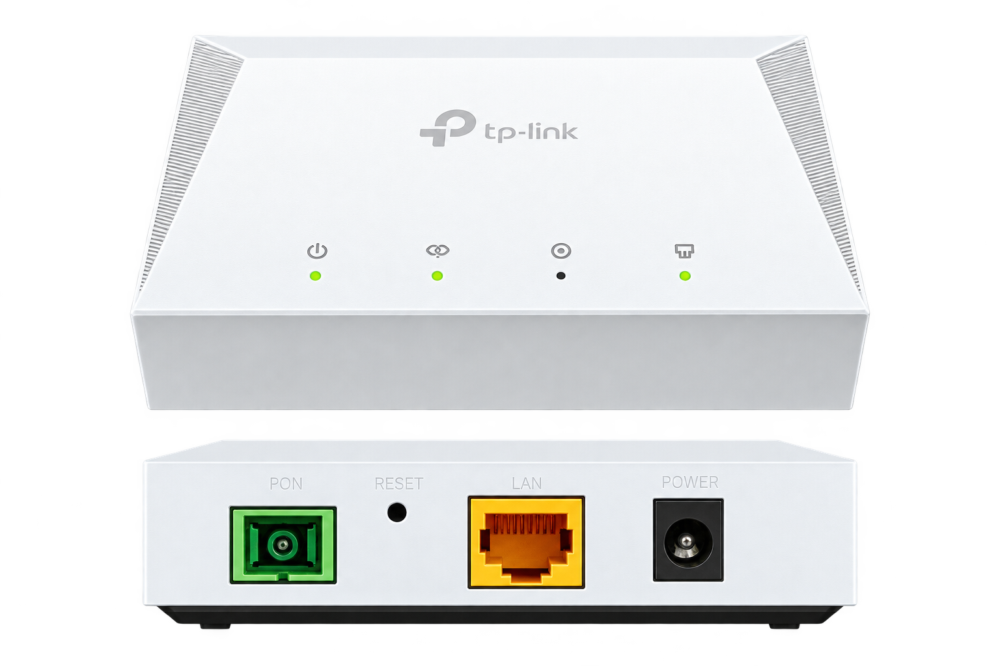

<h1 align="center">TP-Link XZ000-G7 v1.2</h1>
<p align="center">
  
</p>
<p align="center"><strong>Local access · Admin password · Flash backups · Firmware internals</strong></p>
<p align="center">TR variant · Hardware revision v1.20 · Galachip GC1601</p>

The XZ000-G7 is a small GPON/EPON ONT with one Gigabit Ethernet port. This repository documents the TR v1.2 revision: how to reach its management interface, how its default admin password is generated, what a full flash backup contains, and what the firmware actually implements.

Device observations and live access tests used **0.8.0 3.0.0 v608e.0 Build 250926 Rel.61253n**. Hardware revision **v1.20** is the version reported by the device. Firmware findings apply to this build unless stated otherwise.

### Contents

- [Hardware](#hardware)
- [Web access](#web-access)
- [Default admin password](#admin-password)
- [Telnet and root access](#telnet)
- [Access through an OpenWrt router](#openwrt)
- [Back up the device](#backup)
- [Flash layout](#flash-layout)
- [GPON status and OLT information](#gpon)
- [Firmware compatibility](#firmware)
- [Further reading](#research)

---

<a id="hardware"></a>
## 🔧 Hardware

| Component | Observed on TR v1.20 |
|---|---|
| SoC | Galachip GC1601 |
| CPU | Faraday FA626TE, ARMv5TE, one core at 533 MHz |
| RAM | 32 MiB; 4 MiB reserved for the PON SDK |
| Flash | 8 MiB SPI-NOR, JEDEC ID `0x204017` |
| Ethernet | One 10/100/1000 Mbps RJ45 port |
| Optical module | UX3320S BOSA/BOB |
| Console | UART, `115200 8N1` |
| System | Linux 3.16.0, BusyBox 1.23.2, uClibc-ng 1.0.31 |

GPON operation and Ethernet bridging were observed. The firmware also contains EPON support, but EPON activation was not tested on this TR unit. There is no evidence of XG-PON or XGS-PON support. Wi-Fi, USB and VPN names in shared configuration templates do not establish those features on this hardware.

[Hardware details](docs/hardware.md) · [Capability matrix](research/capabilities.md)

---

<a id="web-access"></a>
## 🌐 Web access

The management address on the examined unit is **[http://192.168.10.254/](http://192.168.10.254/)**, with a `/24` subnet mask. Use **HTTP**; HTTPS service was not observed.

For a direct connection, connect the ONT's RJ45 port to your computer and assign the computer an unused address in that subnet.

### Windows 11

1. Connect the ONT's Ethernet port directly to the PC.
2. Press **Win + R**, enter `ncpa.cpl`, and open the connected **Ethernet** adapter's **Properties**. Select **Internet Protocol Version 4 (TCP/IPv4)** and open **Properties**.
3. Select **Use the following IP address** and enter:

   | Setting | Value |
   |---|---|
   | IP address | `192.168.10.2`, if unused |
   | Subnet mask | `255.255.255.0` |
   | Default gateway | Leave blank |
   | DNS servers | Leave blank; the connection uses a numeric address |

4. Save the settings, open **http://192.168.10.254/**, and sign in as `admin` using the password for your own ONT.

After a temporary direct connection, restore the adapter's previous IP and DNS settings. If the ONT stays on your router's WAN port, keep the PC on the router's LAN or Wi-Fi with its usual LAN settings; configure the management path on the router.

The [Windows 11 guide](docs/windows.md) covers both connection methods, PowerShell checks and restoring DHCP.

### Linux

On the directly connected computer:

```sh
PC_IFACE='YOUR_ETHERNET_INTERFACE'
sudo ip link set dev "$PC_IFACE" up
sudo ip addr add 192.168.10.2/24 dev "$PC_IFACE"
ping -c 3 192.168.10.254
```

Open the management address and sign in as `admin`. The password calculation is below. If the ONT remains connected to your router, use the [OpenWrt procedure](#openwrt) instead.

**Router can ping it, but your computer cannot?** Check the computer's route:

```sh
ip -4 route get 192.168.10.254
```

A leftover `192.168.10.2/24` address on a disconnected Ethernet interface can send requests to the wrong port. Remove that old test address before accessing the ONT over Wi-Fi through your router. See [troubleshooting](docs/troubleshooting.md).

---

<a id="admin-password"></a>
## 🔑 Default admin password

The examined firmware derives a device-specific default from the **LAN MAC address**:

```text
"TsPeLbN" + the last four MAC bytes, written as uppercase hexadecimal
```

For example, using a made-up MAC:

```text
LAN MAC:   02:00:00:12:34:56
Suffix:    00123456
Password:  TsPeLbN00123456
```

The included calculator accepts colon-separated, hyphen-separated or plain hexadecimal MAC addresses:

```sh
python3 tools/admin_password.py 02:00:00:12:34:56
```

Use your own ONT's LAN MAC, rather than the router's MAC or the GPON serial number. Different ONTs produce different passwords.

This calculation applies to a **conditional default-initialization path** in Build 250926. It does not recover a password that has been changed, and other firmware or provisioning settings can use a different default.

[Initialization conditions, account roles and disassembly](docs/passwords.md)

---

<a id="telnet"></a>
## 💻 Telnet and root access

Telnet on port 23 was reachable using the admin account:

```sh
telnet 192.168.10.254 23
```

Successful login enters the manufacturer's command interface:

```text
TP-Link(conf)#
```

Start with `help`. The command tables contain these information queries:

```text
dev version
dev show prodName
dev show prodVer
dev show prodSoftVer
dev show prodHardVer
gponctrl show status
gponctrl show optical
```

The commands were identified in the examined CLI binary; not every query was repeated in a live session.

| Access method | Result on the examined firmware |
|---|---|
| Web `admin` | Management interface |
| Telnet `admin` | TP-Link CLI, role 2 |
| UART console | Linux shell running as UID 0 |
| SSH | No SSH server binary found |
| Web `root` | Disabled in the original account configuration |

**UART already provides operating-system root access.** Its account is named `admin`, but its UID is `0`. Telnet CLI permissions and web account roles are separate. A `root` web login does not grant a Linux shell.

An experimental RAM patch allowed a root-slot web login, but added no menus and triggered error `71231` on the management page. A working network shell or permanent web-root unlock has not been demonstrated.

[Access guide and CLI restrictions](docs/access.md)

---

<a id="openwrt"></a>
## 📡 Access through an OpenWrt router

The ONT can stay connected to the router's WAN port. OpenWrt can carry a separate management address on the Ethernet device facing the ONT while PPPoE continues to use its own interface.

```text
Computer ── LAN / Wi-Fi ── OpenWrt ── WAN Ethernet ── ONT
                                               management: 192.168.10.254
```

On the router, first identify the underlying device:

```sh
ubus call network.interface.wan status
ip -br link
```

For a setup using `pppoe-wan` over a VLAN device such as `eth1.35`, the physical device is `eth1`. Your router may use different names or a bridge.

The [OpenWrt guide](docs/openwrt.md) covers the persistent management interface, firewall zone, masquerading and return route. The complete procedure was tested for web and Telnet access. Do not replace the existing PPPoE configuration.

---

<a id="backup"></a>
## 💾 Back up the device

The onboard flash is **SPI-NOR, 8 MiB**. A full read of `/dev/mtd0` includes the bootloader, both firmware banks, configuration and hardware data.

From this repository, start the receiver on a computer reachable as `192.168.10.2`:

```sh
python3 tools/backup_receiver.py --bind 192.168.10.2 --peer 192.168.10.254
```

In the ONT's **Linux shell**, send two independent reads, waiting for each command to finish:

```sh
tftp -p -l /dev/mtd0 -r flash-a.bin 192.168.10.2 1069
tftp -p -l /dev/mtd0 -r flash-b.bin 192.168.10.2 1069
```

Each file must contain **8,388,608 bytes**, and their SHA-256 hashes must match. The receiver also extracts the seven flash partitions. Backups are saved under `local-private/backups/` and excluded from Git.

These commands require the Linux shell; they do not work at `TP-Link(conf)#`. The [backup guide](docs/backup.md) includes the network probe, runtime file capture and verification steps. A main-flash dump does not include a separate EEPROM or OTP/security region.

---

<a id="flash-layout"></a>
## 🗂️ Flash layout

| MTD | Name | Start | End (exclusive) | Size |
|---|---|---:|---:|---:|
| `mtd0` | `whole` | `0x000000` | `0x800000` | 8 MiB |
| `mtd1` | `uboot` | `0x000000` | `0x020000` | 128 KiB |
| `mtd2` | `kernel1` | `0x020000` | `0x180000` | 1,408 KiB |
| `mtd3` | `rootfs1` | `0x180000` | `0x3e0000` | 2,432 KiB |
| `mtd4` | `kernel2` | `0x3e0000` | `0x540000` | 1,408 KiB |
| `mtd5` | `rootfs2` | `0x540000` | `0x7a0000` | 2,432 KiB |
| `mtd6` | `misc` | `0x7a0000` | `0x7f0000` | 320 KiB |
| `mtd7` | `hwconfig` | `0x7f0000` | `0x800000` | 64 KiB |

`whole` overlaps every other partition. The observed active image was bank 2, mounted from `/dev/mtdblock5`.

[Boot sequence, identity record offsets and flash boundaries](docs/flash-layout.md)

---

<a id="gpon"></a>
## 🔬 GPON status and OLT information

The web status page exposes registration state, ONU ID, optical power, temperature, voltage, bias current and traffic counters. **O5** means GPON activation has reached the operational state; VLAN and PPPoE service still depend on the operator's configuration.

The **ONU ID is assigned by the OLT**. It identifies an ONU on that PON and does not reveal the OLT's model, port or subscriber count.

OMCI's OLT-G object (class 131) can contain vendor, equipment and version information. The firmware has a local MIB query for it, but this research did not capture a live response. The normal admin CLI has no confirmed route to that information.

[GPON, optics, VLAN handling and the OLT-G query](docs/gpon.md)

---

<a id="firmware"></a>
## 📦 Firmware compatibility

The older generic V1 firmware package contains a July 2023 build. It shares the CPU platform, Device Tree and kernel configuration with the examined 2025 firmware, but has different product identifiers, regional options and a single-bank boot layout.

**Compatibility with TR v1.20 has not been established.** The normal updater is expected to reject the older package's identifiers; no upload or flash test was performed. The GPL archive also lacks parts of the proprietary application and PON source needed for a complete build.

A raw full-flash backup is not a web-upgrade image.

[Upgrade checks](docs/firmware.md) · [2023 firmware and GPL comparison](research/firmware-comparison.md)

---

<a id="research"></a>
## Further reading

| Topic | Guide |
|---|---|
| Connection, login and boot errors | [Troubleshooting](docs/troubleshooting.md) |
| Supported features and untested paths | [Capability matrix](research/capabilities.md) |
| Linux services and configuration flow | [System internals](research/system.md) |
| XML, GCS heap, ELF and web flags | [Reverse engineering](research/reverse-engineering.md) |
| June / September 2025 differences | [Firmware bank comparison](research/bank-comparison.md) |
| Command tables, schemas and kernel data | [Research catalogue](research/data/README.md) |
| ARM code supporting the findings | [Disassembly excerpts](research/disassembly/README.md) |

The [research notes](research/README.md) distinguish live observations from static analysis and unresolved questions. [Contributions](CONTRIBUTING.md) are welcome, especially results from other revisions. Use synthetic identifiers in examples; raw dumps and device credentials belong in your private workspace.

Independent research; no affiliation with TP-Link, Galachip or an ISP. See [NOTICE](NOTICE.md) for ownership and licensing.
