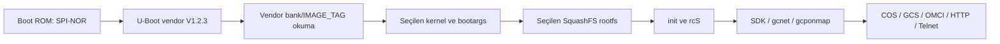

# SPI-NOR, bölüm tablosu ve açılış

Depolama **SPI-NOR**’dur. “NAND yedeği” denilen dosya aslında /dev/mtd0 üzerinden alınan **8.388.608 baytlık ana NOR adres alanıdır**.

## Bölüm tablosu

| MTD | Bölüm | Başlangıç | Bitiş, hariç | Uzunluk |
|---|---|---:|---:|---:|
| mtd0 | whole | 0x000000 | 0x800000 | 8 MiB |
| mtd1 | uboot | 0x000000 | 0x020000 | 128 KiB |
| mtd2 | kernel1 | 0x020000 | 0x180000 | 1408 KiB |
| mtd3 | rootfs1 | 0x180000 | 0x3e0000 | 2432 KiB |
| mtd4 | kernel2 | 0x3e0000 | 0x540000 | 1408 KiB |
| mtd5 | rootfs2 | 0x540000 | 0x7a0000 | 2432 KiB |
| mtd6 | misc | 0x7a0000 | 0x7f0000 | 320 KiB |
| mtd7 | hwconfig | 0x7f0000 | 0x800000 | 64 KiB |

whole diğer yedi bölümle üst üste binen kapsayıcı aygıttır. Sekiz bağımsız depolama çipi veya birbirinden ayrı sekiz alan yoktur. Bankların kernel alanı vendor IMAGE_TAG başlığını da içerir.

Önceki açılışta active/commit index 1, “slave image(1)”, kernel2/rootfs2 ve root=/dev/mtdblock5 görülmüştür. Bu bir başlangıç gözlemidir; tüm cihazların her zaman ikinci banktan açılacağını göstermez.

## Kimlik ve sistem kaydı adresleri

Adresler bu firmware’in native okuyucularıyla eşleştirilmiştir. Tablo içerikleri değil, **yerleşim bilgisi** yayımlar.

| Mutlak adres | İşlev |
|---|---|
| 0x7cb100 | LOID kaydı |
| 0x7cb200 | GPON SN, tip/checksum |
| 0x7cb300 | GPON password, tip/checksum |
| 0x7ce000 | Sign okuyucusunun alanı |
| 0x7cf300 | Device ID alanı |
| 0x7cf500 | Ürün serial okuyucusunun alanı |
| 0x7d0000 | Boot/bank seçimi |
| 0x7e0000 | LAN MAC |
| 0x7f0000 | İlk 4096 bayt sistem bilgi bloğu |
| 0x7f1000 | 4096 bayt optik/BOB bloğu |

GPON parolası web admin parolasıyla aynı kayıt değildir. Sign alanı üzerinden tek başına secure boot sonucu çıkarılamaz. Device ID’nin SPI OTP kimliği olduğu kanıtlanmadı. Harici I²C EEPROM veya ayrı flash OTP/security sektörleri ana MTD dump’ına kendiliğinden dahil olmaz.

## Boot yolu

U-Boot banner’ı V1.2.3, 2025 Eylül derlemesidir; temel kaynakta U-Boot 2020.07 bulunması çelişki değildir. “default environment” uyarısı kalıcı environment yerine derlenmiş varsayılanların kullanıldığını belirtir. Eski printenv bölümleri ve örnek MAC, Linux’un gerçek çalışma düzenini temsil etmeyebilir; vendor boot yolu bootargs’ı oluşturur. fpgaBoot adı fiziksel FPGA kanıtı değildir.

TFTP, HTTP recovery, XMODEM ve multicast girişleri kodda mevcuttur. Geri yükleme deneyi yapılmadı. [JSON bölüm/kayıt haritası](../data/flash-layout.json) ve [yedek yöntemi](04-yedekleme.md).
