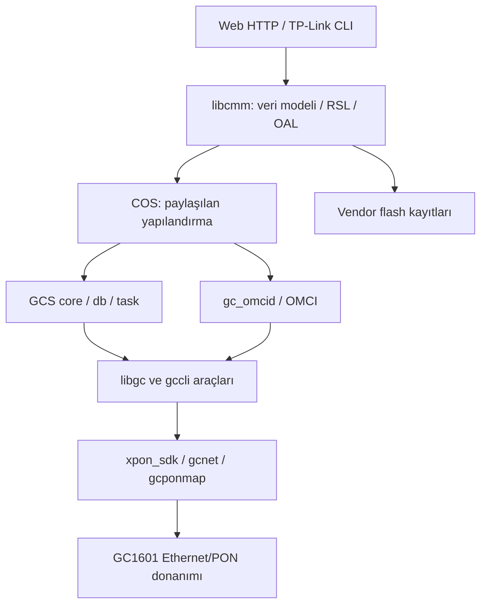

# Linux, dosya sistemi ve servis mimarisi

## Dosya sistemi

Rootfs SquashFS ve salt okunurdur. /etc tmpfs, /var RAM alanıdır. /etc’ye yazılan değişiklikler vendor kaydetme yolu kullanılmadıkça yeniden açılışta kaybolabilir. df’de root %100 dolu görünmesi bu sıkıştırılmış, salt okunur imajda normaldir; boş yer açmak için dosya silinecek bir writable overlay yoktur.

İki rootfs’te 425 inode bulunur: 255 normal dosya, 85 sembolik bağ, 56 dizin, 29 aygıt düğümü. Analiz sırasında modern unsquashfs ile uyumsuz vendor flag 0x400 yalnız kopyada, superblock byte 25 üzerinde kaldırıldı. Yetkisiz mknod yüzünden dönüş kodu 2 olsa da bütün normal dosya/bağlar çıkarıldı; aygıt metadata’sı ayrı saklandı.

## Programlar ve veri yolu

Bu genel akış bütün çağrıların her düğümden geçtiği anlamına gelmez; GPON/VLAN/account yolları ayrı izlenmiştir. gcs_core, gcs_db, gcs_task, cos, gc_omcid, httpd, telnetd ve gcloopdetect önceki süreç listelerinde bulunmuştur. DHCP programının bulunması varsayılan pool’un aktif ve işlevsel olduğunun kanıtı değildir.

| Katman | Sorumluluk | Katalog |
|---|---|---|
| BusyBox | Dar Linux araç seti | [Dosya rolleri](../data/firmware-files.json) |
| httpd | Web doğrulaması ve CGI | [Web sayfaları](../data/web-page-catalog.json) |
| cli | Rol kontrollü üretici komutları | [CLI girdileri](../data/cli-commands.json) |
| libcmm.so | CMM/RSL/OAL, hesaplar, update, GPON | [ELF işlevleri](../data/native-catalog.json) |
| libgc.so | Vendor ioctl/SDK sarmalayıcıları | [ELF işlevleri](../data/native-catalog.json) |
| gc_omcid | OMCI MIB, VLAN ve PON ayarları | [GPON/OMCI](07-gpon-omci-olt.md) |
| xpon_sdk / gcnet / gcponmap | Kernel PON ve ağ sürücüleri | [ELF/modül katalogu](../data/native-catalog.json) |

BusyBox 1.23.2’de id, ip, tar, dd, nc gibi beklenen araçların hepsi derlenmemiştir. Komutları sürüme göre seçin. netstat -lnt çalışır; -p seçeneği yoktur. UID için /proc/self/status kullanılabilir. /etc/passwd içindeki dropbear satırı daemon binary’sinin veya SSH servisinin varlığını kanıtlamaz.

Kernel IPv6/NAT/bridge/802.1Q derlenmiştir; init IPv6’yı kapatır, bazı uç servisleri eksiktir. Yazılım şablonunda BusyBox 1.31.1 geçse de gerçek binary banner’ı 1.23.2’dir. Program/banner ve kernel config, genel şablondan daha güçlü kanıttır.
