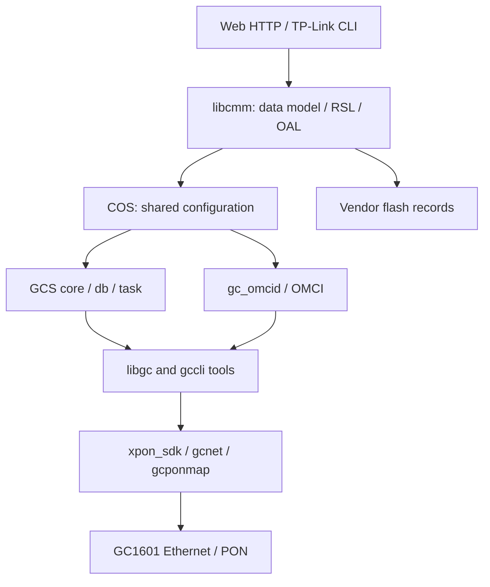

# Linux and service architecture

[Research index](README.md)

## Filesystems

The root filesystem is read-only SquashFS. `/etc` is mounted on tmpfs and `/var` is RAM-backed. Changes to `/etc` can disappear after reboot unless the vendor's configuration-save path persists them. A root filesystem reporting 100% usage in `df` is normal for this fixed image; there is no writable overlay to reclaim by deleting rootfs files.

Each examined rootfs has 425 inodes: 255 regular files, 85 symbolic links, 56 directories and 29 device nodes. For extraction with modern `unsquashfs`, vendor flag `0x400` was cleared at superblock byte 25 **in an analysis copy**. Device-node creation failed without `mknod` permission, yielding exit code 2, while regular files and symlinks were extracted and device metadata was recorded separately.

## Configuration and hardware flow

This summarizes the layers; individual calls need not pass through every node. Account, GPON and VLAN paths were traced separately.

The observed process list included `gcs_core`, `gcs_db`, `gcs_task`, `cos`, `gc_omcid`, `httpd`, `telnetd` and `gcloopdetect`. A DHCP process also appeared, but its presence does not establish a working pool; an empty pool configuration was seen during initialization.

| Component | Responsibility | Reference |
|---|---|---|
| BusyBox | Restricted Linux utility set | [File inventory](data/firmware-files.json) |
| `httpd` | Web authentication and CGI | [Page catalogue](data/web-page-catalog.json) |
| `cli` | Vendor commands and roles | [Command tables](data/cli-commands.json) |
| `libcmm.so` | CMM/RSL/OAL, accounts, update and GPON | [ELF catalogue](data/native-catalog.json) |
| `libgc.so` | Vendor ioctl/SDK wrappers | [ELF catalogue](data/native-catalog.json) |
| `gc_omcid` | OMCI MIB, VLAN and PON settings | [GPON notes](../docs/gpon.md) |
| `xpon_sdk`, `gcnet`, `gcponmap` | Kernel PON/network drivers | [ELF catalogue](data/native-catalog.json) |

## Build versus templates

The actual BusyBox is 1.23.2 and lacks `id`, `ip`, `tar`, `dd` and `nc`. `netstat -lnt` works; `-p` does not. `/proc/self/status` supplies the UID. A `dropbear` account or directory does not establish an SSH daemon.

The kernel includes IPv6, NAT, bridging and 802.1Q, while initialization disables IPv6 and some userspace services are missing. A BusyBox 1.31.1 label in software templates does not override the binary's actual banner. Runtime behavior, binaries and kernel configuration take precedence over inherited template names.
